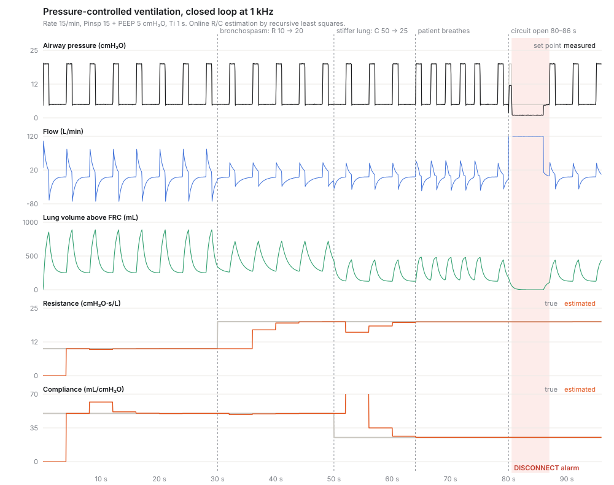

# ventsim

**A closed-loop simulation of pressure-controlled mechanical ventilation, built the way device firmware is built.**

The "firmware" side is separated from the "physics" side. The firmware is a 1 kHz control loop with a set-point ramp, feed-forward and a PI controller with anti-windup, breath cycling with patient triggering, per-breath monitoring, online estimation of lung mechanics and debounced alarms. The physics is a single-compartment lung, a blower with lag and slew limits, patient muscle effort and noisy, quantised sensors. The firmware sees the plant only through its sensors.

The firmware headers are header-only C++17. They use no heap, no exceptions and no RTTI, and CI cross-compiles them for a Cortex-M4F.

[](https://github.com/dusancorlija/ventsim/actions/workflows/ci.yml)



> **Not a medical device.** This is an engineering exercise built on textbook physiology (the single-compartment RC lung model) and generic control techniques. It does not reproduce any manufacturer's design.

## The scenario

`./build/ventsim` runs 96 s of PC-AC ventilation (15/min, Pinsp 15 cmH₂O over PEEP 5, Ti 1 s) while the patient changes underneath it:

| Time | Event | What the firmware does |
|---|---|---|
| 0 s | Passive lung, R = 10 cmH₂O·s/L, C = 50 mL/cmH₂O | Vt 636 mL; estimates converge within two breaths |
| 30 s | Bronchospasm: R → 20 | Vt drops to 445 mL; estimated R follows to 19.9 |
| 50 s | Stiffer lung: C → 25 mL/cmH₂O | Vt drops to 318 mL; estimated C follows to 25.3 |
| 64 s | Patient starts breathing at 24/min | Breaths become patient-triggered; the estimate is frozen (see below) |
| 80 s | Circuit disconnected | Alarm after 0.5 s; blower drops to a standby bias |
| 86 s | Reconnected | Alarm clears, ventilation restarts with a fresh breath |

Per-breath report (excerpt):

| # | Start | Type | Vti (mL) | Vte (mL) | Ppeak | PEEP |
|---:|---:|---|---:|---:|---:|---:|
| 2 | 4.00 s | mandatory | 636 | 637 | 20.3 | 5.0 |
| 16 | 60.01 s | mandatory | 318 | 319 | 20.3 | 5.0 |
| 18 | 66.59 s | triggered | 335 | 334 | 20.2 | 5.0 |
| 19 | 69.10 s | triggered | 332 | 333 | 20.2 | 5.0 |
| 23 | 87.00 s | mandatory | 336 | 315 | 20.2 | 5.0 |

## Engineering notes

**Feed-forward does the heavy lifting.** The blower command is set point + τ·d(set point)/dt + flow·R_circuit, and the PI loop only corrects what is left. The rate term inverts the blower's first-order lag. Without it, the loop trails the 100 ms pressure ramp, the integral charges up and the plateau overshoots by about 1 cmH₂O. With it, the overshoot is 0.2 cmH₂O, which is within sensor noise, and the plateau error averages 0.008 cmH₂O.

**Anti-windup is not optional.** With conditional integration, a PI loop whose actuator is blocked for 2 s overshoots by 0.4 units afterwards. Without it, the overshoot is 10 units (`tests/test_ventsim.cpp`). An open circuit is exactly this situation.

**Disconnection is a mode, not just an alarm.** "Inspiratory flow is high but pressure cannot follow the set point", or "sustained inspiratory flow during expiration", raises the alarm after a 300 ms debounce. The firmware then stops cycling and holds PEEP open-loop instead of driving the blower at full output into an open circuit. The bias flow tells it when the circuit is closed again, and ventilation restarts with a clean breath.

**Lung mechanics by recursive least squares.** The model Paw = R·Q + V/C + P₀ is fitted at 100 Hz with exponential forgetting (about 2 s of memory). Volume is integrated from measured flow and reset at each breath. The fit is O(N²) per sample with N = 3, which is cheap enough for the control loop itself.

**Estimation is transactional.** Patient effort is not in the passive model, so a breath containing effort biases the fit. Mandatory breaths can contain effort too: the first breath at 64 s does. The estimator therefore fits during a breath but commits only when the breath ends cleanly, meaning it was mandatory and ended by its timer rather than by a trigger. Otherwise it rolls back. The displayed values change once per breath, as on a real ventilator, and stay within 0.5 cmH₂O·s/L of the truth through 30 s of spontaneous breathing (tested).

**Plant integrates at 10 kHz** inside each 1 ms control period, so numerical error stays well below sensor noise. The lung is checked against the analytic RC charging curve.

## Tests

`tests/test_ventsim.cpp` runs under ASan and UBSan with GCC and Clang:

- the lung matches the analytic RC response; RLS identifies a known system to 1 %
- anti-windup: 0.4 vs 10 units of overshoot after a blocked actuator; debounce rejects glitches
- pressure tracking: overshoot < 0.5 cmH₂O, mean plateau error < 0.1 cmH₂O
- Vt within 3 % of the analytic value; Vte = Vti; measured PEEP within 0.1 cmH₂O
- breath timing to 2 ms over 60 s
- R and C estimates within 5 %, and immune to 30 s of patient effort
- triggered breaths follow a 24/min patient; disconnection alarm within 0.8 s, standby, recovery
- low tidal volume and high pressure alarms

## Layout

```
include/ventsim/firmware/   ventilator.hpp (loop, cycling, monitoring, alarms), pi_controller.hpp, rls.hpp
include/ventsim/plant/      plant.hpp (lung, blower, patient effort, sensors)
include/ventsim/sim.hpp     closes the loop
src/main.cpp                the scenario -> CSV + per-breath report
src/firmware_target.cpp     firmware-only translation unit for the Cortex-M4F build
tools/plot.py               CSV -> stacked SVG chart, standard library only
```

The firmware keeps all its state in fixed-size arrays (`sizeof(Ventilator)` is about 5.4 KB). It uses `double` for readability. On a Cortex-M4F, whose FPU is single-precision, a production port would use `float`. The algorithms are unchanged, and the RLS update needs care with conditioning.

## Build

```bash
cmake -S . -B build -DCMAKE_BUILD_TYPE=Release && cmake --build build
ctest --test-dir build --output-on-failure
./build/ventsim > docs/scenario.csv 2> breaths.md
python3 tools/plot.py docs/scenario.csv docs/scenario.svg
```

## License

MIT
